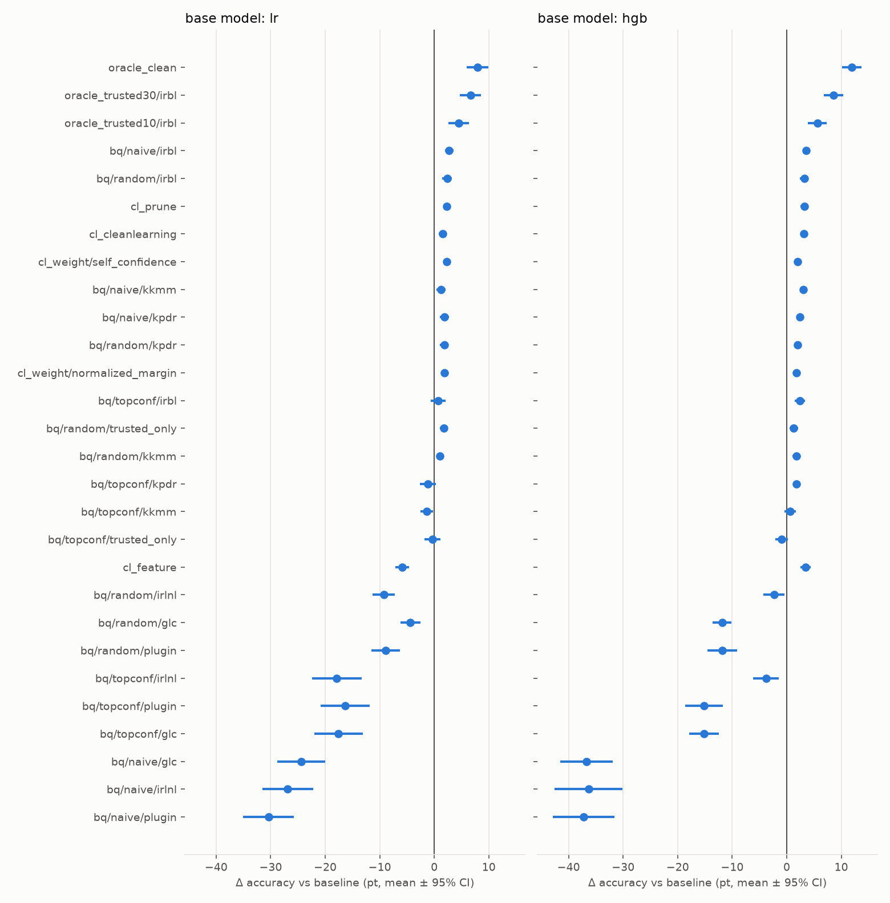

# Results summary

## Mean over all conditions (test accuracy %, difference from baseline in pt)

|                                             |   acc |   Δ vs baseline |   win rate |   mean rank |   fit sec |
|:--------------------------------------------|------:|----------------:|-----------:|------------:|----------:|
| ('hgb', 'ref', 'oracle_clean')              | 88.87 |           11.95 |     100.00 |        1.04 |     25.98 |
| ('hgb', 'ref', 'oracle_trusted30/irbl')     | 85.48 |            8.56 |      94.44 |        2.81 |     62.77 |
| ('hgb', 'ref', 'oracle_trusted10/irbl')     | 82.56 |            5.64 |      76.67 |        8.22 |     61.52 |
| ('hgb', '3', 'bq/naive/irbl')               | 80.49 |            3.56 |      90.00 |        6.76 |     64.74 |
| ('hgb', '4', 'cl_feature')                  | 80.38 |            3.46 |      80.00 |        9.49 |     21.68 |
| ('hgb', '2', 'cl_prune')                    | 80.18 |            3.25 |      83.33 |        8.44 |     22.20 |
| ('hgb', '3', 'bq/random/irbl')              | 80.14 |            3.22 |      81.11 |        8.61 |     60.49 |
| ('hgb', '2', 'cl_cleanlearning')            | 80.12 |            3.19 |      82.22 |        8.81 |     44.00 |
| ('hgb', '3', 'bq/naive/kkmm')               | 79.95 |            3.03 |      85.56 |        9.20 |     31.91 |
| ('hgb', '3', 'bq/topconf/irbl')             | 79.34 |            2.41 |      66.67 |       12.28 |     59.02 |
| ('hgb', '3', 'bq/naive/kpdr')               | 79.32 |            2.40 |      84.44 |       11.66 |     25.59 |
| ('hgb', '4', 'cl_weight/self_confidence')   | 78.92 |            1.99 |      86.67 |       11.78 |     21.66 |
| ('hgb', '3', 'bq/random/kpdr')              | 78.88 |            1.95 |      84.44 |       13.05 |     24.36 |
| ('hgb', '3', 'bq/topconf/kpdr')             | 78.76 |            1.83 |      63.33 |       14.05 |     24.42 |
| ('hgb', '4', 'cl_weight/normalized_margin') | 78.68 |            1.76 |      86.67 |       12.60 |     21.19 |
| ('hgb', '3', 'bq/random/kkmm')              | 78.67 |            1.74 |      65.56 |       14.55 |     50.09 |
| ('hgb', '3', 'bq/random/trusted_only')      | 78.23 |            1.31 |      55.56 |       15.61 |     12.20 |
| ('hgb', '3', 'bq/topconf/kkmm')             | 77.53 |            0.60 |      47.78 |       16.99 |     45.18 |
| ('hgb', '1', 'baseline')                    | 76.93 |            0.00 |       0.00 |       17.06 |     25.71 |
| ('hgb', '3', 'bq/topconf/trusted_only')     | 75.99 |           -0.93 |      38.89 |       18.86 |     10.30 |
| ('hgb', '3', 'bq/random/irlnl')             | 74.61 |           -2.32 |      61.11 |       17.29 |     46.58 |
| ('hgb', '3', 'bq/topconf/irlnl')            | 73.14 |           -3.78 |      57.78 |       17.77 |     52.03 |
| ('hgb', '3', 'bq/random/plugin')            | 65.11 |          -11.81 |       0.00 |       24.38 |     19.24 |
| ('hgb', '3', 'bq/random/glc')               | 65.08 |          -11.84 |       1.11 |       24.92 |     39.62 |
| ('hgb', '3', 'bq/topconf/glc')              | 61.81 |          -15.12 |       1.11 |       24.89 |     44.61 |
| ('hgb', '3', 'bq/topconf/plugin')           | 61.74 |          -15.18 |       1.11 |       24.50 |     22.76 |
| ('hgb', '3', 'bq/naive/irlnl')              | 40.58 |          -36.34 |       6.67 |       26.17 |     33.95 |
| ('hgb', '3', 'bq/naive/glc')                | 40.24 |          -36.69 |       0.00 |       26.96 |     26.86 |
| ('hgb', '3', 'bq/naive/plugin')             | 39.70 |          -37.23 |      10.00 |       26.26 |     15.28 |
| ('lr', 'ref', 'oracle_clean')               | 81.10 |            7.95 |      98.89 |        1.49 |      0.70 |
| ('lr', 'ref', 'oracle_trusted30/irbl')      | 79.78 |            6.64 |      80.00 |        4.24 |      1.18 |
| ('lr', 'ref', 'oracle_trusted10/irbl')      | 77.62 |            4.48 |      61.11 |       10.49 |      1.08 |
| ('lr', '3', 'bq/naive/irbl')                | 75.87 |            2.73 |      82.22 |        6.82 |      0.78 |
| ('lr', '3', 'bq/random/irbl')               | 75.49 |            2.35 |      63.33 |        8.73 |      0.71 |
| ('lr', '4', 'cl_weight/self_confidence')    | 75.46 |            2.32 |      88.89 |        7.33 |      0.23 |
| ('lr', '2', 'cl_prune')                     | 75.43 |            2.28 |      82.22 |        8.08 |      0.29 |
| ('lr', '3', 'bq/random/kpdr')               | 75.00 |            1.86 |      61.11 |       10.91 |      0.56 |
| ('lr', '3', 'bq/naive/kpdr')                | 75.00 |            1.85 |      56.67 |       11.73 |      0.45 |
| ('lr', '4', 'cl_weight/normalized_margin')  | 74.98 |            1.83 |      81.11 |        9.37 |      0.23 |
| ('lr', '3', 'bq/random/trusted_only')       | 74.92 |            1.77 |      57.78 |       11.18 |      0.12 |
| ('lr', '2', 'cl_cleanlearning')             | 74.67 |            1.53 |      65.56 |       10.72 |     45.68 |
| ('lr', '3', 'bq/naive/kkmm')                | 74.39 |            1.24 |      43.33 |       12.65 |      3.25 |
| ('lr', '3', 'bq/random/kkmm')               | 74.20 |            1.05 |      50.00 |       12.95 |     15.42 |
| ('lr', '3', 'bq/topconf/irbl')              | 73.84 |            0.70 |      46.67 |       12.92 |      0.74 |
| ('lr', '1', 'baseline')                     | 73.14 |            0.00 |       0.00 |       13.32 |      0.38 |
| ('lr', '3', 'bq/topconf/trusted_only')      | 72.79 |           -0.35 |      43.33 |       14.74 |      0.11 |
| ('lr', '3', 'bq/topconf/kpdr')              | 72.00 |           -1.15 |      35.56 |       16.50 |      0.52 |
| ('lr', '3', 'bq/topconf/kkmm')              | 71.78 |           -1.37 |      30.00 |       18.13 |      9.31 |
| ('lr', '3', 'bq/random/glc')                | 68.78 |           -4.37 |      21.11 |       19.59 |      1.01 |
| ('lr', '4', 'cl_feature')                   | 67.28 |           -5.86 |      11.11 |       21.23 |      0.35 |
| ('lr', '3', 'bq/random/plugin')             | 64.25 |           -8.89 |       3.33 |       20.82 |      0.19 |
| ('lr', '3', 'bq/random/irlnl')              | 63.88 |           -9.27 |       6.67 |       23.53 |      0.97 |
| ('lr', '3', 'bq/topconf/plugin')            | 56.79 |          -16.36 |       8.89 |       22.95 |      0.26 |
| ('lr', '3', 'bq/topconf/glc')               | 55.58 |          -17.57 |      12.22 |       23.31 |      1.44 |
| ('lr', '3', 'bq/topconf/irlnl')             | 55.28 |          -17.86 |      18.89 |       23.01 |      1.22 |
| ('lr', '3', 'bq/naive/glc')                 | 48.78 |          -24.36 |       0.00 |       25.36 |      1.36 |
| ('lr', '3', 'bq/naive/irlnl')               | 46.29 |          -26.86 |       2.22 |       26.19 |      1.33 |
| ('lr', '3', 'bq/naive/plugin')              | 42.77 |          -30.37 |       5.56 |       26.69 |      0.16 |

## hgb: Δ by noise kind x noise rate (pt, mean over 3 datasets x 5 seeds)

| method                      |   ('instance', 0.2) |   ('instance', 0.4) |   ('pair', 0.2) |   ('pair', 0.4) |   ('symmetric', 0.2) |   ('symmetric', 0.4) |
|:----------------------------|--------------------:|--------------------:|----------------:|----------------:|---------------------:|---------------------:|
| oracle_clean                |                7.23 |               16.96 |            6.52 |           27.51 |                 3.26 |                10.19 |
| oracle_trusted30/irbl       |                3.69 |               10.90 |            4.18 |           24.22 |                 1.68 |                 6.69 |
| oracle_trusted10/irbl       |                0.15 |                5.68 |            2.61 |           21.40 |                -0.45 |                 4.44 |
| bq/naive/irbl               |                0.92 |                2.67 |            3.73 |            7.48 |                 1.29 |                 5.27 |
| cl_feature                  |                0.34 |                3.74 |            2.63 |            9.97 |                -0.46 |                 4.51 |
| cl_prune                    |                0.46 |                3.19 |            2.99 |            7.13 |                 0.51 |                 5.23 |
| bq/random/irbl              |                0.23 |                2.93 |            3.19 |            7.36 |                 0.76 |                 4.85 |
| cl_cleanlearning            |                0.83 |                3.23 |            2.85 |            6.70 |                 0.46 |                 5.07 |
| bq/naive/kkmm               |                0.42 |                2.69 |            2.92 |            7.13 |                 0.64 |                 4.39 |
| bq/topconf/irbl             |               -0.83 |                2.61 |            2.09 |            7.06 |                -0.55 |                 4.11 |
| bq/naive/kpdr               |               -0.18 |                1.74 |            2.89 |            6.06 |                 0.72 |                 3.14 |
| cl_weight/self_confidence   |                0.78 |                1.43 |            2.16 |            3.09 |                 0.88 |                 3.61 |
| bq/random/kpdr              |               -0.03 |                1.47 |            2.06 |            4.92 |                 0.44 |                 2.85 |
| bq/topconf/kpdr             |               -0.99 |                2.12 |            1.49 |            5.90 |                -0.26 |                 2.74 |
| cl_weight/normalized_margin |                0.65 |                1.63 |            2.09 |            3.21 |                 0.48 |                 2.49 |
| bq/random/kkmm              |               -0.29 |                1.72 |            1.79 |            4.80 |                -0.38 |                 2.81 |
| bq/random/trusted_only      |               -0.81 |                2.58 |           -0.12 |            5.10 |                -1.96 |                 3.05 |
| bq/topconf/kkmm             |               -2.65 |                2.50 |           -0.51 |            5.64 |                -3.31 |                 1.95 |
| baseline                    |                0.00 |                0.00 |            0.00 |            0.00 |                 0.00 |                 0.00 |
| bq/topconf/trusted_only     |               -4.15 |                2.40 |           -3.09 |            4.79 |                -6.02 |                 0.50 |
| bq/random/irlnl             |                0.47 |                1.00 |           -2.09 |           -4.06 |                -0.47 |                -8.75 |
| bq/topconf/irlnl            |                0.60 |                1.03 |           -4.21 |          -10.14 |                -0.63 |                -9.35 |
| bq/random/plugin            |               -2.69 |               -3.74 |          -10.22 |          -15.05 |                -8.28 |               -30.88 |
| bq/random/glc               |               -6.65 |               -3.18 |          -16.12 |          -15.62 |               -11.19 |               -18.30 |
| bq/topconf/glc              |               -5.44 |               -5.95 |          -19.80 |          -21.87 |               -13.33 |               -24.31 |
| bq/topconf/plugin           |               -1.29 |               -4.80 |          -17.82 |          -24.21 |                -9.63 |               -33.35 |
| bq/naive/irlnl              |               -9.91 |              -10.18 |          -61.43 |           -7.68 |               -64.59 |               -64.25 |
| bq/naive/glc                |              -26.29 |              -21.20 |          -52.48 |          -26.30 |               -53.12 |               -40.74 |
| bq/naive/plugin             |              -43.67 |              -33.31 |          -21.08 |           -5.88 |               -62.42 |               -57.03 |

## hgb: Δ by dataset (pt)

| method                      |   covtype |   digits |   synth |
|:----------------------------|----------:|---------:|--------:|
| oracle_clean                |      8.87 |    13.64 |   13.33 |
| oracle_trusted30/irbl       |      4.14 |    11.03 |   10.51 |
| oracle_trusted10/irbl       |      1.15 |     8.11 |    7.65 |
| bq/naive/irbl               |      1.36 |     4.91 |    4.41 |
| cl_feature                  |      1.00 |     5.98 |    3.39 |
| cl_prune                    |      0.64 |     4.98 |    4.13 |
| bq/random/irbl              |      0.23 |     5.14 |    4.29 |
| cl_cleanlearning            |      0.51 |     5.04 |    4.02 |
| bq/naive/kkmm               |      1.04 |     4.51 |    3.54 |
| bq/topconf/irbl             |     -1.46 |     5.01 |    3.70 |
| bq/naive/kpdr               |      1.57 |     3.04 |    2.57 |
| cl_weight/self_confidence   |      0.89 |     2.99 |    2.10 |
| bq/random/kpdr              |      0.93 |     2.43 |    2.49 |
| bq/topconf/kpdr             |     -0.26 |     3.10 |    2.65 |
| cl_weight/normalized_margin |      0.77 |     2.61 |    1.89 |
| bq/random/kkmm              |     -0.77 |     3.16 |    2.84 |
| bq/random/trusted_only      |     -1.44 |     3.09 |    2.27 |
| bq/topconf/kkmm             |     -2.86 |     3.04 |    1.62 |
| baseline                    |      0.00 |     0.00 |    0.00 |
| bq/topconf/trusted_only     |     -3.79 |     0.81 |    0.18 |
| bq/random/irlnl             |     -8.68 |     0.83 |    0.90 |
| bq/topconf/irlnl            |    -11.78 |    -0.25 |    0.67 |
| bq/random/plugin            |    -20.98 |    -8.23 |   -6.22 |
| bq/random/glc               |    -16.01 |   -11.02 |   -8.50 |
| bq/topconf/glc              |    -20.02 |   -17.22 |   -8.12 |
| bq/topconf/plugin           |    -26.71 |    -9.54 |   -9.30 |
| bq/naive/irlnl              |    -31.70 |   -41.78 |  -35.54 |
| bq/naive/glc                |    -21.12 |   -53.56 |  -35.39 |
| bq/naive/plugin             |    -31.28 |   -46.13 |  -34.28 |

## lr: Δ by noise kind x noise rate (pt, mean over 3 datasets x 5 seeds)

| method                      |   ('instance', 0.2) |   ('instance', 0.4) |   ('pair', 0.2) |   ('pair', 0.4) |   ('symmetric', 0.2) |   ('symmetric', 0.4) |
|:----------------------------|--------------------:|--------------------:|----------------:|----------------:|---------------------:|---------------------:|
| oracle_clean                |                2.74 |                5.58 |            7.83 |           22.90 |                 3.19 |                 5.47 |
| oracle_trusted30/irbl       |                1.07 |                2.93 |            7.17 |           21.95 |                 2.33 |                 4.37 |
| oracle_trusted10/irbl       |               -1.33 |                0.39 |            5.36 |           19.94 |                 0.25 |                 2.26 |
| bq/naive/irbl               |                0.19 |               -0.18 |            5.37 |            6.91 |                 1.92 |                 2.16 |
| bq/random/irbl              |                0.04 |               -0.50 |            5.25 |            5.33 |                 1.83 |                 2.15 |
| cl_weight/self_confidence   |                1.00 |                0.67 |            3.78 |            3.17 |                 2.31 |                 2.98 |
| cl_prune                    |                0.70 |                0.76 |            4.54 |            3.87 |                 1.61 |                 2.21 |
| bq/random/kpdr              |               -0.31 |               -0.04 |            4.58 |            4.37 |                 1.11 |                 1.46 |
| bq/naive/kpdr               |               -0.48 |               -0.18 |            4.39 |            5.77 |                 0.86 |                 0.74 |
| cl_weight/normalized_margin |                0.85 |                0.59 |            3.63 |            2.80 |                 1.55 |                 1.58 |
| bq/random/trusted_only      |                0.07 |                0.41 |            4.16 |            3.11 |                 1.16 |                 1.73 |
| cl_cleanlearning            |                0.46 |                0.30 |            4.17 |            2.92 |                 0.64 |                 0.68 |
| bq/naive/kkmm               |               -0.39 |               -0.49 |            3.80 |            5.80 |                -0.23 |                -1.04 |
| bq/random/kkmm              |               -0.33 |               -0.59 |            3.97 |            2.93 |                 0.26 |                 0.09 |
| bq/topconf/irbl             |               -1.12 |               -0.73 |            3.01 |            3.26 |                -0.38 |                 0.14 |
| baseline                    |                0.00 |                0.00 |            0.00 |            0.00 |                 0.00 |                 0.00 |
| bq/topconf/trusted_only     |               -1.12 |                0.48 |            1.34 |            0.81 |                -2.17 |                -1.46 |
| bq/topconf/kpdr             |               -1.91 |               -0.71 |           -0.15 |            1.07 |                -2.61 |                -2.57 |
| bq/topconf/kkmm             |               -2.38 |               -1.26 |           -0.13 |            1.20 |                -2.77 |                -2.87 |
| bq/random/glc               |               -1.59 |               -0.78 |           -1.49 |           -8.55 |                -7.05 |                -6.73 |
| cl_feature                  |               -1.66 |               -2.76 |           -6.07 |           -8.97 |                -5.31 |               -10.40 |
| bq/random/plugin            |               -1.22 |               -1.61 |           -6.63 |           -9.83 |               -14.21 |               -19.88 |
| bq/random/irlnl             |               -8.91 |               -5.27 |           -6.85 |           -9.39 |               -15.52 |                -9.67 |
| bq/topconf/plugin           |               -2.15 |               -4.93 |          -15.53 |          -21.52 |               -20.05 |               -33.94 |
| bq/topconf/glc              |               -1.03 |               -6.14 |          -18.10 |          -23.74 |               -25.10 |               -31.27 |
| bq/topconf/irlnl            |               -4.49 |               -6.01 |          -14.00 |          -23.08 |               -28.06 |               -31.56 |
| bq/naive/glc                |               -9.75 |               -7.66 |          -32.78 |          -25.11 |               -38.60 |               -32.27 |
| bq/naive/irlnl              |              -10.67 |               -8.99 |          -34.85 |          -23.44 |               -46.12 |               -37.07 |
| bq/naive/plugin             |              -30.34 |              -24.21 |          -18.73 |           -9.32 |               -49.56 |               -50.07 |

## lr: Δ by dataset (pt)

| method                      |   covtype |   digits |   synth |
|:----------------------------|----------:|---------:|--------:|
| oracle_clean                |      2.84 |    15.86 |    5.15 |
| oracle_trusted30/irbl       |      2.02 |    13.47 |    4.42 |
| oracle_trusted10/irbl       |      0.29 |    10.30 |    2.85 |
| bq/naive/irbl               |      0.53 |     5.22 |    2.43 |
| bq/random/irbl              |     -0.53 |     5.41 |    2.17 |
| cl_weight/self_confidence   |      0.41 |     5.35 |    1.20 |
| cl_prune                    |      0.14 |     5.48 |    1.22 |
| bq/random/kpdr              |     -0.69 |     4.48 |    1.79 |
| bq/naive/kpdr               |     -0.43 |     5.54 |    0.45 |
| cl_weight/normalized_margin |      0.18 |     4.32 |    1.00 |
| bq/random/trusted_only      |     -1.14 |     5.37 |    1.09 |
| cl_cleanlearning            |     -1.42 |     4.78 |    1.22 |
| bq/naive/kkmm               |     -1.22 |     3.57 |    1.38 |
| bq/random/kkmm              |     -1.14 |     2.85 |    1.46 |
| bq/topconf/irbl             |     -5.89 |     7.01 |    0.98 |
| baseline                    |      0.00 |     0.00 |    0.00 |
| bq/topconf/trusted_only     |     -7.49 |     6.73 |   -0.31 |
| bq/topconf/kpdr             |     -7.53 |     5.72 |   -1.63 |
| bq/topconf/kkmm             |     -6.64 |     3.33 |   -0.79 |
| bq/random/glc               |     -9.26 |     0.90 |   -4.73 |
| cl_feature                  |    -11.10 |    -0.68 |   -5.81 |
| bq/random/plugin            |    -19.15 |    -4.54 |   -2.99 |
| bq/random/irlnl             |    -12.09 |    -4.92 |  -10.79 |
| bq/topconf/plugin           |    -37.62 |    -2.03 |   -9.42 |
| bq/topconf/glc              |    -37.62 |    -2.01 |  -13.07 |
| bq/topconf/irlnl            |    -38.02 |    -1.59 |  -13.99 |
| bq/naive/glc                |    -10.10 |   -36.83 |  -26.15 |
| bq/naive/irlnl              |    -15.51 |   -38.06 |  -27.00 |
| bq/naive/plugin             |    -29.51 |   -40.50 |  -21.11 |

## cleanlab detection and noise rates of the pseudo trusted/untrusted sets (%)

|                                      |   actual_noise_rate |   cl_flag_rate |   cl_precision |   cl_recall |   naive_trusted_noise |   naive_untrusted_noise |   topconf_trusted_noise |   topconf_untrusted_noise |   random_trusted_noise |   random_untrusted_noise |
|:-------------------------------------|--------------------:|---------------:|---------------:|------------:|----------------------:|------------------------:|------------------------:|--------------------------:|-----------------------:|-------------------------:|
| ('hgb', 'covtype', 'instance', 0.2)  |               20.00 |          24.14 |          42.49 |       51.27 |                 12.85 |                   42.49 |                    6.89 |                     25.58 |                  13.29 |                    22.86 |
| ('hgb', 'covtype', 'instance', 0.4)  |               40.00 |          31.30 |          63.07 |       49.35 |                 29.49 |                   63.07 |                   21.05 |                     48.05 |                  30.05 |                    44.23 |
| ('hgb', 'covtype', 'pair', 0.2)      |               20.00 |          30.80 |          51.61 |       79.42 |                  5.95 |                   51.61 |                    6.86 |                     25.45 |                   9.54 |                    24.34 |
| ('hgb', 'covtype', 'pair', 0.4)      |               40.00 |          44.58 |          55.28 |       61.60 |                 27.69 |                   55.28 |                   31.81 |                     43.50 |                  34.46 |                    42.37 |
| ('hgb', 'covtype', 'symmetric', 0.2) |               20.00 |          30.29 |          57.78 |       87.50 |                  3.59 |                   57.78 |                    3.55 |                     26.66 |                   5.82 |                    25.74 |
| ('hgb', 'covtype', 'symmetric', 0.4) |               40.00 |          45.77 |          73.30 |       83.88 |                 11.89 |                   73.30 |                   15.18 |                     49.23 |                  18.35 |                    48.05 |
| ('hgb', 'digits', 'instance', 0.2)   |               19.97 |          16.91 |          84.41 |       71.47 |                  6.85 |                   84.41 |                    0.74 |                     28.19 |                   6.59 |                    25.69 |
| ('hgb', 'digits', 'instance', 0.4)   |               40.02 |          32.08 |          85.14 |       68.27 |                 18.68 |                   85.14 |                    9.83 |                     52.93 |                  20.98 |                    48.16 |
| ('hgb', 'digits', 'pair', 0.2)       |               19.97 |          25.71 |          71.22 |       91.63 |                  2.25 |                   71.22 |                    0.11 |                     28.49 |                   2.65 |                    27.40 |
| ('hgb', 'digits', 'pair', 0.4)       |               40.02 |          46.83 |          56.26 |       65.84 |                 25.69 |                   56.26 |                   19.08 |                     49.00 |                  24.70 |                    46.59 |
| ('hgb', 'digits', 'symmetric', 0.2)  |               19.97 |          22.07 |          85.84 |       94.82 |                  1.32 |                   85.84 |                    0.00 |                     28.56 |                   1.00 |                    28.13 |
| ('hgb', 'digits', 'symmetric', 0.4)  |               40.02 |          45.01 |          84.49 |       95.03 |                  3.61 |                   84.49 |                    0.16 |                     57.08 |                   3.34 |                    55.71 |
| ('hgb', 'synth', 'instance', 0.2)    |               20.00 |          21.01 |          57.36 |       60.27 |                 10.06 |                   57.36 |                    2.44 |                     27.53 |                   9.86 |                    24.35 |
| ('hgb', 'synth', 'instance', 0.4)    |               40.00 |          28.83 |          70.84 |       51.06 |                 27.50 |                   70.84 |                   13.28 |                     51.45 |                  28.34 |                    45.00 |
| ('hgb', 'synth', 'pair', 0.2)        |               20.00 |          26.39 |          66.92 |       88.27 |                  3.19 |                   66.92 |                    0.48 |                     28.37 |                   3.27 |                    27.17 |
| ('hgb', 'synth', 'pair', 0.4)        |               40.00 |          45.76 |          57.33 |       65.59 |                 25.37 |                   57.33 |                   19.23 |                     48.90 |                  25.34 |                    46.28 |
| ('hgb', 'synth', 'symmetric', 0.2)   |               20.00 |          25.56 |          71.82 |       91.73 |                  2.22 |                   71.82 |                    0.18 |                     28.49 |                   2.51 |                    27.49 |
| ('hgb', 'synth', 'symmetric', 0.4)   |               40.00 |          42.35 |          82.00 |       86.80 |                  9.15 |                   82.00 |                    1.42 |                     56.53 |                   8.93 |                    53.31 |
| ('lr', 'covtype', 'instance', 0.2)   |               20.00 |          22.02 |          38.66 |       42.56 |                 14.73 |                   38.66 |                    8.26 |                     25.03 |                  14.84 |                    22.21 |
| ('lr', 'covtype', 'instance', 0.4)   |               40.00 |          27.14 |          71.31 |       48.37 |                 28.34 |                   71.31 |                   16.02 |                     50.28 |                  29.22 |                    44.62 |
| ('lr', 'covtype', 'pair', 0.2)       |               20.00 |          33.37 |          49.03 |       81.82 |                  5.45 |                   49.03 |                    5.26 |                     25.82 |                   8.28 |                    24.62 |
| ('lr', 'covtype', 'pair', 0.4)       |               40.00 |          42.98 |          63.39 |       68.36 |                 21.98 |                   63.39 |                   26.10 |                     45.49 |                  29.61 |                    44.08 |
| ('lr', 'covtype', 'symmetric', 0.2)  |               20.00 |          33.73 |          51.34 |       86.58 |                  4.05 |                   51.34 |                    4.13 |                     26.10 |                   6.29 |                    25.27 |
| ('lr', 'covtype', 'symmetric', 0.4)  |               40.00 |          46.70 |          73.14 |       85.39 |                 10.96 |                   73.14 |                   13.27 |                     49.22 |                  16.65 |                    48.06 |
| ('lr', 'digits', 'instance', 0.2)    |               19.97 |          14.88 |          88.96 |       66.22 |                  7.92 |                   88.96 |                    0.05 |                     28.49 |                   8.87 |                    24.72 |
| ('lr', 'digits', 'instance', 0.4)    |               40.02 |          32.14 |          91.59 |       73.56 |                 15.59 |                   91.59 |                    5.26 |                     54.88 |                  17.21 |                    49.77 |
| ('lr', 'digits', 'pair', 0.2)        |               19.97 |          27.96 |          61.44 |       85.98 |                  3.88 |                   61.44 |                    0.79 |                     28.19 |                   3.71 |                    26.94 |
| ('lr', 'digits', 'pair', 0.4)        |               40.02 |          46.21 |          54.79 |       63.26 |                 27.32 |                   54.79 |                   23.79 |                     46.98 |                  28.14 |                    45.11 |
| ('lr', 'digits', 'symmetric', 0.2)   |               19.97 |          23.29 |          78.40 |       91.39 |                  2.24 |                   78.40 |                    0.00 |                     28.56 |                   2.43 |                    27.51 |
| ('lr', 'digits', 'symmetric', 0.4)   |               40.02 |          42.07 |          86.01 |       90.42 |                  6.62 |                   86.01 |                    0.48 |                     56.94 |                   6.48 |                    54.37 |
| ('lr', 'synth', 'instance', 0.2)     |               20.00 |          19.22 |          38.87 |       37.36 |                 15.51 |                   38.87 |                    6.10 |                     25.96 |                  15.33 |                    22.00 |
| ('lr', 'synth', 'instance', 0.4)     |               40.00 |          24.26 |          73.91 |       44.82 |                 29.14 |                   73.91 |                   11.90 |                     52.04 |                  29.44 |                    44.53 |
| ('lr', 'synth', 'pair', 0.2)         |               20.00 |          32.56 |          51.29 |       83.41 |                  4.92 |                   51.29 |                    1.74 |                     27.83 |                   4.76 |                    26.53 |
| ('lr', 'synth', 'pair', 0.4)         |               40.00 |          46.05 |          55.99 |       64.45 |                 26.36 |                   55.99 |                   19.97 |                     48.58 |                  25.86 |                    46.06 |
| ('lr', 'synth', 'symmetric', 0.2)    |               20.00 |          29.45 |          58.81 |       86.59 |                  3.80 |                   58.81 |                    1.02 |                     28.13 |                   3.87 |                    26.91 |
| ('lr', 'synth', 'symmetric', 0.4)    |               40.00 |          38.98 |          81.28 |       79.20 |                 13.64 |                   81.28 |                    3.48 |                     55.64 |                  13.45 |                    51.37 |
